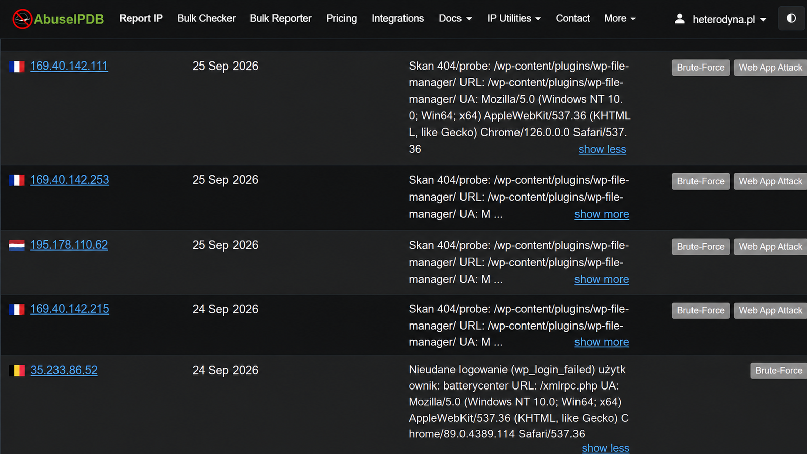
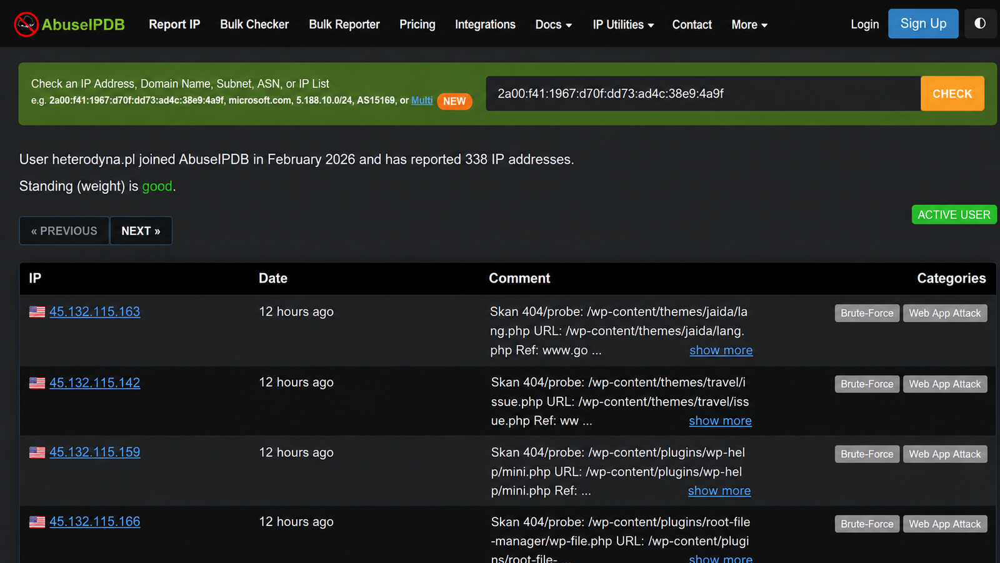
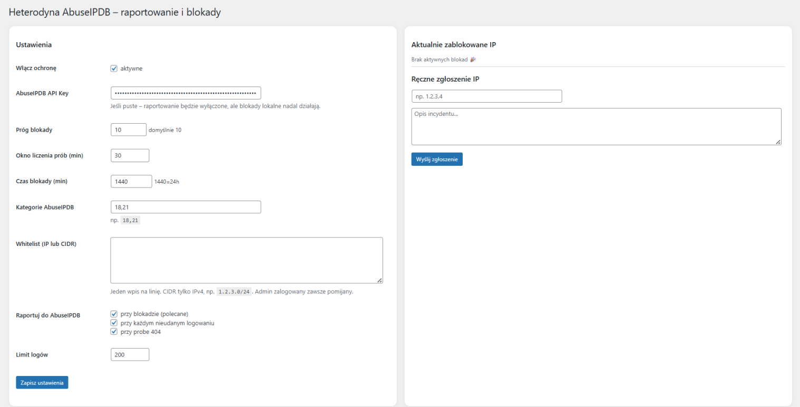

# Heterodyna AbuseIPDB

**Heterodyna AbuseIPDB** to wtyczka zabezpieczająca WordPress, która wykrywa podejrzaną aktywność, czasowo blokuje adresy IP i może raportować incydenty do AbuseIPDB.

**Pobierz wtyczkę:** https://testpro.com.pl/wp-content/uploads/2026/04/heterodyna-abuseipdb.zip

## Główne funkcje

- automatyczne blokowanie IP po przekroczeniu skonfigurowanego progu,
- konfigurowalne okno czasowe i czas blokady,
- wykrywanie nieudanych logowań i podejrzanych prób 404,
- automatyczne lub ręczne raportowanie adresów IP do AbuseIPDB,
- wybór kategorii AbuseIPDB,
- lokalny log incydentów i blokad,
- whitelist IP i IPv4 CIDR,
- pomijanie zalogowanego administratora,
- konfiguracja limitu logów i zdarzeń raportowanych do AbuseIPDB.

## Integracja z AbuseIPDB

Klucz API AbuseIPDB jest opcjonalny dla lokalnych blokad, ale wymagany do wysyłania raportów. Wtyczka może raportować m.in. zdarzenia typu **Brute-Force** i **Web App Attack**.

### Publiczne raporty AbuseIPDB

## Panel WordPress

W panelu administratora można włączyć ochronę, ustawić próg blokady, okno liczenia prób, czas blokady, kategorie AbuseIPDB, whitelistę oraz zasady raportowania.

## Whitelist

Lista wyjątków pozwala wykluczyć pojedyncze adresy IP lub podsieci IPv4 w formacie CIDR, np. `192.168.1.0/24`.

## Wymagania

- WordPress 6.0 lub nowszy,
- PHP zgodne z wymaganiami używanej wersji WordPress,
- klucz API AbuseIPDB tylko wtedy, gdy ma być aktywne raportowanie do AbuseIPDB.

## Autor

**Heterodyna Team Software**  
https://heterodynateamsoftware.pl
